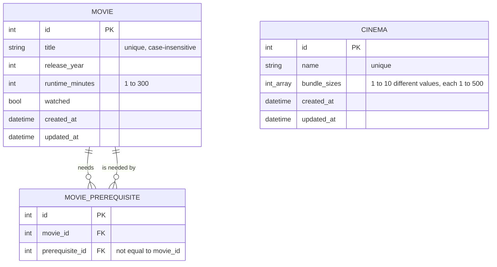

# Doomsday Ready 🎬

Plan your movie marathon, and book cinema seats for the whole group.

Built for the **Blinto Talent Accelerator 2027** Full Stack Developer Internship assessment.

## Deployed 
https://doomsday-ready-psi.vercel.app

## What is this project?

Two small problems, one app:

1. **Marathon planner.** Movies can have prerequisites ("watch these first"). Pick the movie you want to watch and the app tells you everything you must watch before it: each movie once, in a valid order, with your watched progress and the time still left. It also rejects circular prerequisites (A needs B, B needs A).
2. **Group booking.** Cinemas don't sell single tickets, only **bundles** (for example packs of 2 and 5). For a group of N people, the app finds the **fewest bundles that add up to exactly N**, or says "not possible".

The frontend has three pages: **Movies**, **Rewatch Plan** and **Booking**.

## Features

- Add movies with prerequisites; edit prerequisites later; mark movies as watched
- Circular prerequisites are rejected on create and on update (`409 CIRCULAR_DEPENDENCY`)
- Rewatch order: all transitive prerequisites, each once, in a valid order, target excluded, plus watched count and remaining runtime
- Cinemas with 1 to 10 different bundle sizes (each 1 to 500)
- Booking quote for groups of 1 to 10,000: fewest bundles, exact total, or "not possible"
- One consistent error format across the whole API
- 80+ automated tests, ruff-clean backend
- One-command start with Docker Compose

## Tech stack

| Part         | Choice                                     |
| ------------ | ------------------------------------------ |
| Backend      | Python, Django 6, Django REST Framework    |
| Database     | PostgreSQL                                 |
| Frontend     | React + TypeScript (Vite), react-router    |
| Tests / lint | pytest + pytest-django, ruff               |
| Run          | Docker Compose (Postgres, gunicorn, nginx) |

## Quick start (Docker)

```bash
git clone https://github.com/Nafis-Rohan/Mesh-Movies.git
cd Mesh-Movies
docker compose up --build
```

(On older installs the command is `docker-compose`.)

- App: http://localhost:8080
- API: http://localhost:8000/api

On first start the backend runs the migrations and loads demo data (8 movies with prerequisites, 4 cinemas). Set `SEED_DATA=false` on the backend service to skip the demo data.

The browser only talks to nginx, which forwards `/api` to the backend, so no CORS setup is needed.

## Run without Docker

You need Python 3.12+, Node 20+ and a running PostgreSQL.

**Backend**

```bash
cd backend
python -m venv .venv
.venv\Scripts\activate          # macOS/Linux: source .venv/bin/activate
pip install -r requirements.txt
```

Create `backend/.env`:

```
DJANGO_SECRET_KEY=change-me
DJANGO_DEBUG=true
POSTGRES_DB=mesh_movies
POSTGRES_USER=postgres
POSTGRES_PASSWORD=your-password
POSTGRES_HOST=localhost
POSTGRES_PORT=5432
```

Then:

```bash
python manage.py migrate
python manage.py seed           # optional demo data
python manage.py runserver
```

**Frontend** (second terminal)

```bash
cd frontend
npm install
npm run dev
```

Open http://localhost:5173. Vite forwards `/api` to the backend on port 8000.

**Tests**

```bash
cd backend
pytest
ruff check .
```

## API

All routes live under `/api` and have no trailing slash.

| Method | Route                              | What it does                                                                                         |
| ------ | ---------------------------------- | ---------------------------------------------------------------------------------------------------- |
| POST   | `/movies`                          | Create a movie (prerequisites by id or title). Accepts one movie or a list; a list is all-or-nothing |
| GET    | `/movies`                          | List movies                                                                                          |
| PATCH  | `/movies/:id`                      | Update a movie (title, year, runtime, watched, prerequisites)                                        |
| GET    | `/movies/:id/rewatch-order`        | Everything to watch before this movie, in order                                                      |
| POST   | `/cinemas`                         | Create a cinema with its bundle sizes                                                                |
| GET    | `/cinemas`                         | List cinemas                                                                                         |
| GET    | `/cinemas/:id/booking?groupSize=N` | Cheapest exact combination of bundles for N people                                                   |

**Rewatch order response**

```json
{
  "target": { "id": 3, "title": "The Avengers" },
  "order": [
    {
      "id": 1,
      "title": "Iron Man",
      "releaseYear": 2008,
      "runtimeMinutes": 126,
      "watched": true
    }
  ],
  "totalCount": 2,
  "watchedCount": 1,
  "unwatchedCount": 1,
  "remainingRuntimeMinutes": 124
}
```

**Booking response**

```json
{
  "cinema": { "id": 1, "name": "Blockbuster Cinema", "bundleSizes": [2, 5] },
  "groupSize": 9,
  "possible": true,
  "totalBundles": 3,
  "bundles": [
    { "size": 5, "count": 1 },
    { "size": 2, "count": 2 }
  ]
}
```

When no combination works, the response is still HTTP 200 with `"possible": false` and a message. It's a valid answer, not an error.

**Errors** always look the same:

```json
{ "error": { "code": "CIRCULAR_DEPENDENCY", "message": "...", "details": {} } }
```

Codes include `VALIDATION_ERROR`, `CIRCULAR_DEPENDENCY` (HTTP 409, with the loop in `details`), duplicate title or cinema name, unknown prerequisite, and `INVALID_GROUP_SIZE`. The full list is in `backend/core/exceptions.py`.

## Data model: Designed by me; Mermaid diagram generated by Claude from my schema



Movies form a graph through `MOVIE_PREREQUISITE`. Cinemas are standalone. Database constraints back up the API rules: a movie can't be its own prerequisite, titles are unique ignoring case, and runtime must be 1 to 300.

## How the algorithms work

All of the logic below is hand-written, with no graph or solver libraries. The graph code lives in `backend/movies/services/graph.py` and the bundle code in `backend/cinemas/services/bundles.py`. Both are pure functions with no Django imports, so they are easy to test.

**Rewatch order**

1. Walk backwards from the target with BFS and collect every prerequisite once. A movie shared by two branches still appears once.
2. Sort them with Kahn's topological sort, so every movie comes after its own prerequisites.
3. Ties are broken by release year, then title, so the order is stable and predictable.

**Circular prerequisites**

- When you update a movie's prerequisites, a BFS from the new prerequisites checks whether it can reach the movie itself. If so, the update is rejected and the loop is returned, for example `A → B → A`.
- When a list of movies is created in one request, an iterative 3-colour depth-first search checks the whole new graph.
- Writes that change the graph take a PostgreSQL advisory lock, so two requests at the same moment can't create a cycle together.

**Booking: fewest bundles**
This is the "minimum coin change" problem, solved with dynamic programming. `best[n]` is the fewest bundles that make exactly `n` people: `best[n] = min(best[n - size] + 1)` over all bundle sizes. We fill the table from 0 up to the group size, then walk back to see which bundles were used.

Why not just take the biggest bundle first? Take bundles of 3 and 4 and a group of 6: biggest-first picks 4, then can't finish. The right answer is 3 + 3. The unit tests include this case.

## Assumptions and decisions

- Movie titles are unique, ignoring upper/lower case.
- Runtime is 1 to 300 minutes.
- Updating prerequisites replaces the whole set.
- The rewatch order does not include the target movie, but does include watched prerequisites (shown ticked).
- Ties in the order are broken by release year, then title.
- A list of movies in one request is all-or-nothing: if any is invalid, nothing is saved.
- "Not possible" for a booking is a normal 200 response, not an error.
- No login: it isn't required, so I kept the app simple on purpose.
- URLs have no trailing slash (`APPEND_SLASH` is off) so there are no surprise redirects.

## Project structure

```
backend/    Django project (movies, cinemas, core apps), tests, Dockerfile
frontend/   React app (pages, components, api client), nginx.conf, Dockerfile
docker-compose.yml
```

## Challenges and debugging

**The movie cards.** I wanted the Movies page to show a card per movie with a watched icon and pop-ups for add and edit. The first result was a vertical stack of text with no borders, and the page was even throwing a TypeScript error. There were two causes. The card component code had ended up inside `MoviesPage.tsx` instead of its own `MovieCard.tsx` file, which is why TypeScript said the page was missing the props `movie`, `onToggleWatched` and `onEdit`. And the card CSS had never been saved into `index.css`, so there was no grid and no borders. I moved the component into its own file and added the CSS, and the cards, the grid and the pop-ups worked.

## How I used AI

I'm honest about this because the assessment asks for it. I used **Claude (Anthropic) Free** as a step-by-step pair programmer for the whole project.

- **What Claude did:** it drafted the plan and wrote most of the code in small steps, including the backend CRUD, the graph and bundle algorithms with their unit tests, the React pages and the Docker setup. The algorithms are written without any solver or graph library.
- **What I did:** I chose the stack (Django REST Framework, PostgreSQL, React) and the workflow (one `feature/*` branch and pull request per feature). I typed or pasted every step myself, ran it, and tested the API in Postman and the app in the browser. I reviewed the code, asked for changes (for example the card layout and pop-ups) and debugged the problems that came up.
- **CRUD:** I'm very comfortable with CRUD, so I handed that part to Claude from the assessment's requirements and then reviewed the result before using it.
- **Algorithms:**half of the algorithm code was written with Claude, and I went through it and the tests that cover it. I'm not claiming I wrote it alone.

## Future work

- Login and per-user watch lists (I left auth out on purpose to keep this simple, and I plan to add it later)
- Pagination for large movie lists
- Deleting movies and cinemas
